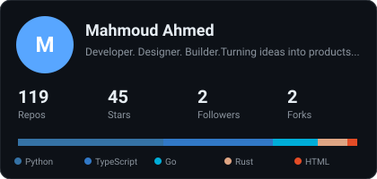

# profileforge

> Generate a beautiful GitHub profile README + dev card in one command.

[](https://go.dev)
[](LICENSE)
[](https://github.com/v01dst/profileforge/releases)
[](https://github.com/v01dst/profileforge)

**profileforge** fetches your public GitHub data and writes a polished profile README (with stats, top languages, featured projects, badges) and an SVG dev card — in one command. Zero dependencies, single static binary.



## ✨ Features

- 📊 **Stats** — repos, stars, followers, forks, account age
- 🗣️ **Top languages** — computed from your actual repos
- 🌟 **Featured projects** — your most-starred repos, auto-selected
- 🎨 **Themes** — dark & light, with matching badges
- 🖼️ **SVG dev card** — embeddable anywhere (README, blog, slides)
- 🪶 **Zero dependencies** — Go stdlib only; single static binary
- ⚡ **Fast** — one API pass, ~1s for a typical profile
- 🔑 **Optional token** — works unauthenticated (60 req/hr) or with `GITHUB_TOKEN`

## 🚀 Install

### From release (recommended)

Download the binary for your OS from [Releases](https://github.com/v01dst/profileforge/releases), then:

```bash
chmod +x profileforge
./profileforge --version
```

### From source

```bash
go install github.com/v01dst/profileforge@latest
```

### Build locally

```bash
git clone https://github.com/v01dst/profileforge
cd profileforge
go build -o profileforge .
```

## 🧪 Quick start

```bash
# Generate README.md + card.svg in the current directory
profileforge v01dst

# Light theme, output to a folder
profileforge v01dst -theme light -out ./profile

# Only the README
profileforge v01dst -card=false

# With a token (higher rate limit)
GITHUB_TOKEN=ghp_xxx profileforge v01dst
```

## 📖 Output

`README.md` — drop it into a repo named after your username (e.g. `v01dst/v01dst`) and GitHub renders it on your profile.

`card.svg` — embed anywhere:

```markdown

```

## 🎨 Themes

| Dark | Light |
|------|-------|
| `profileforge user -theme dark` | `profileforge user -theme light` |

## ⚙️ Flags

| Flag | Default | Description |
|------|---------|-------------|
| `-out` | `.` | output directory |
| `-theme` | `dark` | `dark` or `light` |
| `-card` | `true` | generate SVG dev card |
| `-readme` | `true` | generate README.md |
| `-token` | (env) | GitHub token (or `GITHUB_TOKEN`) |
| `-version` | | print version |

## 🤝 Contributing

PRs welcome. See [CONTRIBUTING.md](CONTRIBUTING.md).

## 📜 License

MIT — see [LICENSE](LICENSE).

---

*Built with ❤️ and Go's standard library. If this helped you, a ⭐ is appreciated!*